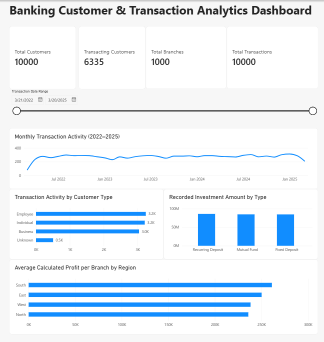

# Banking Customer & Transaction Analytics | PostgreSQL

A reproducible SQL portfolio case study using a **synthetic banking dataset** consisting of **10,000 customer records, 10,000 transaction records, and 1,000 branch records**. The project covers data import, data-quality assessment, analysis-ready table creation, and descriptive banking analytics.

**Tools:** PostgreSQL 18, pgAdmin 4, SQL (joins, CTEs, aggregations and conditional aggregation).

**Status:** Core SQL analysis complete. A Power BI dashboard is a planned extension and **is not included** in this repository.

## Objectives

- Assess completeness, identifier integrity, and relationships across banking tables.
- Preserve raw data while creating analysis-ready customer, transaction, and branch tables.
- Explore account-type balances, customer segments, monthly transaction activity, and recorded investment amounts.
- Compare provisional calculated branch profitability across regions while clearly documenting financial data limitations.

## Workflow

`Source CSVs → public staging tables → data-quality SQL → analytics schema → business-analysis SQL → documented findings`

## Key findings

- **Customer profiles:** 1,420 of 10,000 records (**14.2%**) lack at least one of age, city, or customer type. The other 8,580 are complete for those fields.
- **Customer transaction coverage:** 6,335 customers appear in the supplied transaction records; 3,665 have no transaction in this dataset (not necessarily inactive bank customers).
- **Monthly activity:** January 2025 has the most recorded transactions (**312**); August 2024 has the largest monthly sum of transaction amounts (**817,073.43**). The data spans 37 observed months from March 2022 through March 2025, with partial boundary months.
- **Recorded investment amounts:** Recurring Deposits have the largest category total (**86,002,806** monetary units), narrowly ahead of Mutual Funds and Fixed Deposits. These are sums across transaction rows, **not confirmed new investment flows**.
- **Regional calculated profitability:** South leads in average *calculated* profit per financially comparable branch (**261,196.52** units); West has the highest calculated-loss branch rate (**26.29%**).
- **Financial reconciliation issue:** For **942 of 950** comparable branch records, the reported and independently calculated profit margins differ by more than **1 percentage point**. The source definition of `profit_margin` is not verified; neither value should be presented as audited financial performance.

Read the [business insights](results/business_insights.md) and [data-quality report](results/data_quality_report.md) for detailed explanations.

## Repository structure

```text
banking-customer-transaction-analysis-sql/
├── README.md
├── data/
│   └── dataset_source.md
├── sql/
│   ├── 01_create_tables.sql
│   ├── 02_data_quality_checks.sql
│   ├── 03_remaining_data_quality_checks.sql
│   ├── 04_create_analytics_tables.sql
│   └── 05_business_analysis.sql
└── results/
    ├── data_quality_report.md
    ├── business_insights.md
    └── monthly_transaction_summary.csv
```

## Reproduce the analysis

1. Obtain `bank_data.csv`, `customer_data.csv`, and `transaction_data.csv` from the [original Kaggle dataset](https://www.kaggle.com/datasets/yogeshtekawade/banking-and-customer-transaction-data). The raw files are not redistributed here; check the source's reuse terms.
2. Create a PostgreSQL database named `banking_analytics` and connect to it using pgAdmin.
3. Run `sql/01_create_tables.sql` to create the staging tables in the `public` schema.
4. Import each source CSV into its respective `public` table using pgAdmin's Import/Export tool (CSV format, header enabled). Verify the row counts.
5. Run `sql/02_data_quality_checks.sql` and `sql/03_remaining_data_quality_checks.sql` to reproduce the validation results.
6. Run `sql/04_create_analytics_tables.sql` to create `analytics.customers_clean`, `analytics.transactions_clean`, and `analytics.branches_clean` and verify counts and references.
7. Run the queries in `sql/05_business_analysis.sql`, and compare the outputs with `results/business_insights.md` and the monthly summary CSV.

**Rebuild note:** `CREATE TABLE IF NOT EXISTS` will not refresh previously created analytics tables. The scripts are intended for a fresh setup; deliberate refreshes require rebuilding the snapshots.

## Interpretation and data limitations

- **Synthetic records:** Findings are not claims about the performance of a real bank.
- **Unknown currency:** Monetary amounts have no confirmed currency label.
- **Unit of analysis:** Average balances describe **transaction rows**, not unique accounts or customers. Investment amount totals may include repeated snapshots.
- **Incomplete data:** 50 branch records have missing revenue and cannot be included in the calculated-margin comparison.
- **Unreconciled margins:** `reported_profit_margin` is preserved separately from provisional metrics calculated from revenue and expenses.
- **Observation period:** Transaction dates run from **2022-03-21 to 2025-03-20**; March 2022 and March 2025 are incomplete observation months.

## Project progress

- [x] PostgreSQL setup and raw CSV import
- [x] Data-quality and financial-discrepancy checks
- [x] Analysis-ready customer, transaction, and branch tables
- [x] Six SQL business analyses and supporting reports
- [ ] Power BI dashboard and visuals created and validated separately
- [ ] Optional extensions: customer cohort analysis, source-defined KPI reconciliation, and more robust time comparisons

## Power BI Dashboard

An interactive Power BI dashboard was developed using analysis-ready PostgreSQL tables.

### Dashboard Features

- **KPI Cards:** Total Customers, Transacting Customers, Total Transactions, and Total Branches.
- **Monthly Transaction Trends:** Transaction activity over the observed period (March 2022–March 2025).
- **Customer Segmentation:** Transaction activity across customer types.
- **Investment Analysis:** Comparison of recorded investment amounts by investment category.
- **Regional Financial Performance:** Average calculated profit per comparable branch.
- **Interactive Date Filter:** Allows users to filter transaction-related metrics by date.

### Dashboard Preview



**Notes:** The dashboard uses synthetic banking data. Financial currency units are unspecified, and reported profit margins remain unreconciled. The PBIX includes an imported data snapshot; refreshing requires access to a compatible PostgreSQL database.
